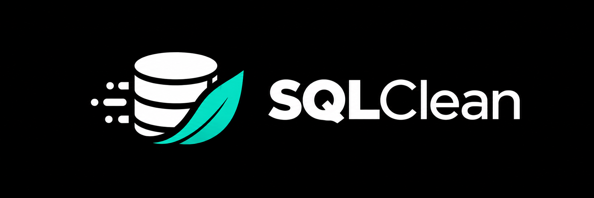

<p align="center">
  
</p>

<p align="center">
  <strong>Clean SQL, every time.</strong> Fast linting, safe fixes and one canonical format.
</p>

SQLClean checks `.sql` files against built-in Rules, applies their fixes and formats every file in
one canonical layout. The engine and the `sqlclean` command are written in Rust. Custom Rules
are plain Python functions that read structural facts about each statement.

<p align="center">
  
</p>

`sqlclean check` reports a bare `JOIN`, a `COUNT(1)` and a temporary table from a custom Rule.
`sqlclean fix` applies the two fixes and formats the file; the custom Rule's finding has no fix,
so it stays.

## Install

```bash
uv tool install sqlclean        # or: pip install sqlclean
sqlclean --version
```

The `sqlclean` package installs the native `sqlclean` executable. Custom Rules run in the same
Python environment as that executable.

## Commands

```bash
sqlclean check [PATHS]...    # report findings; exit 1 when there are any
sqlclean fix [PATHS]...      # apply safe fixes until stable, then format
sqlclean format [PATHS]...   # rewrite files in the canonical layout
sqlclean rules [CODE]        # list the Rules, or explain one
```

- With no paths, a command reads every matching file under the configuration root.
- `check` and `fix` accept `--select` and `--ignore`, which take codes or prefixes such as
  `SQC001` or `SQC`, and `--no-cache`.
- `check --output-format` takes `text`, `json` or `sarif`. Use SARIF for code-scanning uploads.
- `fix --unsafe-fixes` also applies fixes that can change query results. `fix --diff` and
  `format --diff` print a unified diff instead of writing.
- `format --check` fails when a file needs formatting, without writing it.
- Exit status is 0 when clean, 1 when there are findings or files to change, and 2 on errors.

Each statement is formatted on its own. Statements are separated by one blank line, and every
file ends with a newline. Formatting is idempotent: a formatted file formats to itself.

## Configuration

SQLClean reads the nearest `sqlclean.toml` at or above the working directory, or the file passed
with `--config`. Paths in it are relative to the file's directory.

```toml
dialect = "duckdb"            # default "generic"
include = ["**/*.sql"]
exclude = ["vendor/**"]       # files ignored by .gitignore are skipped too

[[dialects]]                  # a different dialect for some paths
paths = ["warehouse/**"]
dialect = "snowflake"

[format]
line_width = 100
indent = 4

[rules]
select = ["SQC"]              # omit to run the Rules enabled by default
ignore = ["SQC027"]
custom = ["sql_rules"]        # Python files or directories that define custom Rules

[rules.thresholds]
max_literal_length = 100      # SQC044
max_ranking_order_by = 5      # SQC043

[rules.rule_options.XSQCNAME001]
prefixes = ["tmp_", "scratch_"]

[[rules.rule_exceptions]]     # one reviewed finding that is allowed
rule = "SQC038"
path = "models/calendar.sql"
relation = "dates"            # optional: the joined relation the CROSS JOIN reads
reason = "Every pair of dates is needed."

[[rules.rule_ignores]]        # Rules that do not apply to some paths
rules = ["SQC034"]
paths = ["scratch/**"]
reason = "Exploratory queries."
```

An exception that no longer matches a finding is reported as stale, so exceptions are removed
when the SQL they cover changes. A parse error is reported as `SQC999` and cannot be ignored.

Results are cached in `.sqlclean/cache/`, keyed by file content, dialect, selection, options and
the custom Rule sources. The directory has its own `.gitignore`.

## Rules

Built-in Rules have `SQC###` codes. Run `sqlclean rules` for the full list, or
`sqlclean rules SQC001` for one Rule. A finding's fix is applied by `sqlclean fix`. `SQC001` turns
`= NULL` into `IS NULL`, which changes which rows match, so it needs `--unsafe-fixes`.

## Custom Rules

A custom Rule is a function decorated with `@rule`. Its first keyword parameter names its
subject:

- `statement: Statement` runs once per statement.
- `file: SqlFile` runs once per file.
- `repository: Repository` runs once over every checked file.

Its second parameter receives a `RuleContext`. Codes are `XSQC`, optional capital letters, and
three digits, such as `XSQCNAME001`.

```python
from sqlclean import FixSafety, RuleContext, RuleOption, Statement, rule

PREFIXES = RuleOption.string_list(
    name="prefixes", default=("tmp_",), description="Table prefixes that must not be read."
)


@rule(
    code="XSQCNAME001",
    message="Query reads a temporary table",
    remediation="Read from the published table instead.",
    options=(PREFIXES,),
    enabled_by_default=True,
)
def temporary_table(*, statement: Statement, ctx: RuleContext) -> list:
    prefixes = ctx.option(PREFIXES)
    return [
        ctx.finding(subject=statement, node=table)
        for table in statement.tables
        if table.name.startswith(prefixes)
    ]


@rule(
    code="XSQCSTYLE001",
    message="COUNT(1) should be COUNT(*)",
    remediation="Write COUNT(*).",
    fixable=FixSafety.SAFE,
    enabled_by_default=True,
)
def count_one(*, statement: Statement, ctx: RuleContext) -> list:
    counts = {f.end + 1 for f in statement.functions if f.name.upper() == "COUNT"}
    return [
        ctx.finding(subject=statement, node=literal, fix=[ctx.replace(node=literal, text="*")])
        for literal in statement.literals
        if literal.text == "1" and literal.start in counts
    ]
```

- A `Statement` exposes `kind` and `text`, plus located `ctes`, `tables`, `joins`, `stars`,
  `functions`, `columns` and `literals`. Each node has `start` and `end` character offsets in
  the file, `line`, `column` and its `text`.
- `statement.polyglot_ast()` returns the full Polyglot syntax tree. It needs
  `pip install "sqlclean[ast]"`.
- Fixes are lists of edits made with `ctx.replace`, `ctx.insert_before`, `ctx.insert_after` and
  `ctx.delete`. A fixing Rule declares `fixable` as `FixSafety.SAFE`, or as `FixSafety.UNSAFE`
  when the fix can change results.
- Options are declared with `RuleOption.boolean`, `integer`, `string` or `string_list`, set under
  `[rules.rule_options.<CODE>]`, and validated before any Rule runs.
- Files named `test_*.py` and `conftest.py` under custom Rule paths are not loaded as Rules.

### Testing custom Rules

```python
from sqlclean.testing import RuleCase, evaluate_rule

from sql_rules.naming import temporary_table


def test_temporary_tables_are_reported() -> None:
    result = evaluate_rule(
        rule=temporary_table,
        test_case=RuleCase(
            description="reads tmp_orders",
            source="SELECT * FROM tmp_orders",
            dialect="duckdb",
            expected_finding_count=1,
        ),
    )
    assert result.fixed_source == "SELECT * FROM tmp_orders"
```

`evaluate_rule` parses the SQL with the same native engine as `sqlclean check`. It fails when the
finding count differs, and when the Rule's findings change with the order of `files`.

## Editors, CI and pre-commit

Run `sqlclean check` in CI. `--output-format sarif` produces a report for code-scanning tools,
and `--output-format json` produces one for other integrations. Editors can run
`sqlclean format` on save.

```yaml
# .pre-commit-config.yaml
repos:
  - repo: https://github.com/sqlstack-io/sqlclean
    rev: v0.0.1
    hooks:
      - id: sqlclean-fix
      - id: sqlclean-format
```

`sqlclean-check` is also available for hooks that must not change files.

## Using the engine from Rust

`crates/sqlclean` is the engine without the command. Tools that template or compile SQL can call
it directly and keep their own configuration and Rule codes:

- `sql_lint::main::lint::lint` lints one SQL text. `sql_lint::main::engine::lint_json` and
  `batch_engine::lint_batch_json` do the same through JSON requests.
- `sql_lint::main::formatter::format_json` formats SQL.
- `sql_lint::main::catalogue::catalogue` and `default_rules::default_rules` describe the Rules.
- `sql_facts::main::file_facts::file_facts` returns the statement facts custom Rules read.

Requests can carry external identifiers and declared relation keys, so a host tool can tell the
Rules about names it resolves itself.

## Development

```bash
uv sync --all-groups   # builds the native executable into .venv
make check             # format, lint, type-check, fensu and clippy
make test              # Rust and Python tests
```

## License

Apache-2.0
